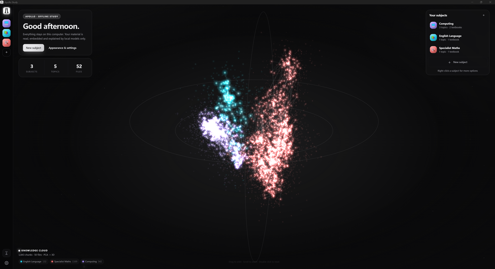
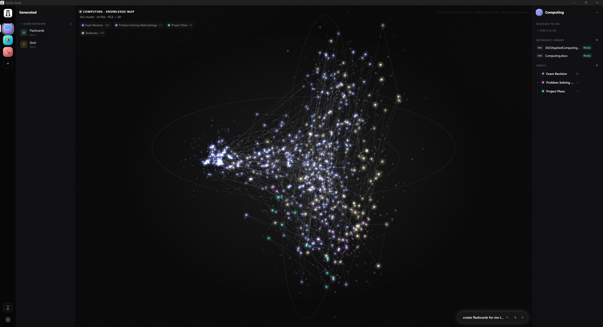
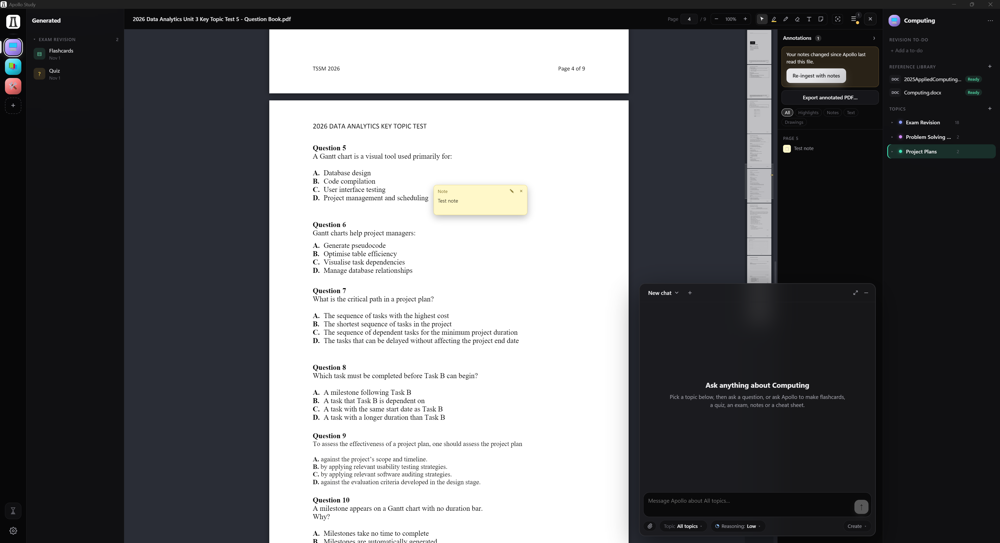
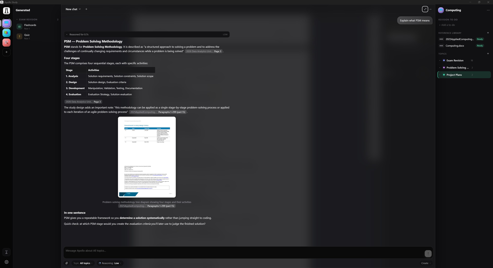
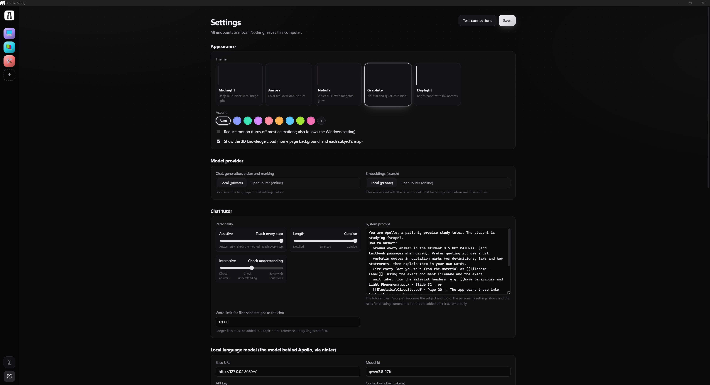
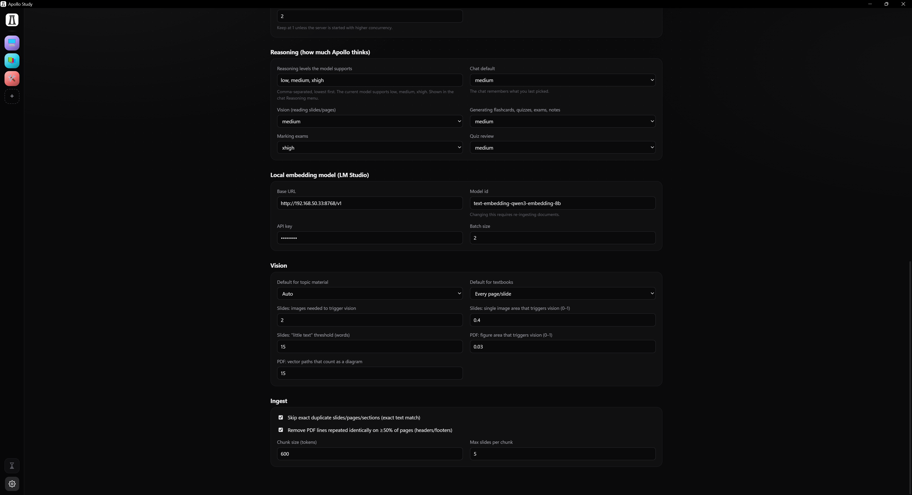

# Apollo (offline AI study app)

Electron + React frontend, Python (FastAPI) sidecar backend. Local models by default; online models via OpenRouter are optional.

## Screenshots

| Home | Subject workspace |
|:--:|:--:|
|  |  |
| Vector database projection cloud of all content | Add specific topics or entire subject materials|

| Document viewer | Chat with citations |
|:--:|:--:|
|  |  |
| Annotate, markup, note and modify any documents like a PDF |Verifiable claims made by an LLM| 

| Settings | Subject menu |
|:--:|:--:|
|  |  |
|Tailor Apollo to suit your needs| Customise the app to your liking |

## Requirements
- OpenAI compatible API (with vision and embedding enabled)
- Node 20+, [uv](https://docs.astral.sh/uv/)

Endpoints, model ids and keys can be changed in the app under **Settings**. On first run they're seeded from a `.env` file in the repo root — copy `.env.example` and fill it in.

### Online models (optional, off by default)
Settings → **Model provider** switches chat/generation and embeddings to [OpenRouter](https://openrouter.ai) independently. Put `OPENROUTER_API_KEY` in `.env` (never commit it). **Anything sent to an online model leaves your computer: it is logged on external servers and may be used for training or other purposes.** The app asks before switching and shows a globe badge in the left bar while online models are on. Free models are often rate limited; requests are retried with backoff.

## Setup (once)
```
cd backend && uv sync
cd ../app && npm install
```

## Run
```
cd app
npm run dev      # Vite + Electron with hot reload (backend on 127.0.0.1:47615)
npm start        # production build of the UI + Electron
```
Electron starts the backend itself and stops it on exit. App data (database, copied files, vision images) lives in `%APPDATA%\Apollo Study\data`.

## Building a Portable exe
```
cd app
npm run dist     # UI build + PyInstaller backend + electron-builder → app/release/ApolloStudy-<version>-portable.exe
```
One self-contained exe (no install). Data still lives in `%APPDATA%\Apollo Study\data`. A `.env` placed next to the exe seeds endpoints and keys on first run. The exe is unsigned, so Windows SmartScreen may warn on first launch ("More info" → "Run anyway").

If electron-builder fails with "Cannot create symbolic link" while unpacking `winCodeSign`, either turn on Windows Developer Mode or unpack that archive manually into `%LOCALAPPDATA%\electron-builder\Cache\winCodeSign\winCodeSign-2.6.0` (the two failing files are macOS-only).

## Tests
```
cd backend
uv run pytest            # offline unit tests (HTTP mocked, throwaway data dir)
uv run pytest --online   # also live OpenRouter checks (sends synthetic test text only)
```

## Using it

### Getting started
1. **Create a subject** — `+` on the left minibar (or *New subject* on the home screen). Right click to customise.
2. **Create a topic** —  Create a topic within a subject to group material and everything you generate.
3. **Upload study material** — Drag files in (PPTX, DOCX, PDF, text, images), or click on `+` to upload reference material. Each file is parsed into units (slides/pages/sections), exactly deduplicated, chunked and embedded.
4. **Vision notes** — a second pass has a vision model annotate slides/pages (auto mode: units with images or little text). Progress shows on the jobs bar at the bottom of the rail (note that this is very slow).
5. **Reference library** — Upload entire textbooks and other entire subject materials into the reference libary. All data stays locally on your device (unless an online API is used).

### Chat Window
- Pick a **topic** (or *All topics*) and a **reasoning level** (Off / Low / Medium / XHigh — levels set in Settings), then ask.
- Apollo answers from your material and **cites** it inline — click a citation to open that slide/page.
- Quick actions under the input — **Flashcards, Quiz, Exam, Full notes, Cheat sheet** — open a short form, then generate and save to the *Generated* panel (grouped by topic).
- Ask Apollo to generate you this content - it can also tailor it to what you struggle with most.
- Opening a document floats the chat bottom-left (collapse with ▾).

### Viewing documents
Click a document in a topic to open the viewer. A toolbar in the top right helps you annotate and work through content.

### Studying
- **Quizzes/Flashcards** open fullscreen. With flashcards, mark `✓` / `✗`under each card for confidence. Marking `✗` lets Apollo know in chat the topics you are struggling with.

### Settings
- Endpoints, model ids and keys (local or OpenRouter - online mode is optional), themes, accent colour, Reduce motion, 3D knowledge cloud.
- **Browser preview of the UI** (dev only): `http://localhost:5173/?backend=PORT` points the page at a backend on another port.

## Layout
- `backend/studyapp/`: `parsers.py` (PPTX/DOCX/PDF/text/images, native Python), `omml.py` (equations → LaTeX), `dedupe.py` (exact, deterministic), `pipeline.py` (parse → dedupe → chunk → embed → vision notes), `jobs.py` (persistent queue), `search.py` (BM25 + vectors), `context.py` (material Qwen reads), `generate.py` (flashcards/quiz/notes/cheat sheet/exam + marking), `chat_api.py` (streaming chat + tool forms), `api.py`
- `app/electron/`: main process (spawns backend, blocks all non-localhost traffic from the UI; online model calls go through the backend), preload
- `app/src/`: React UI
- `spike/`: Phase 0 experiments

## Note
- FULLY vibecoded btw (but it works tho)