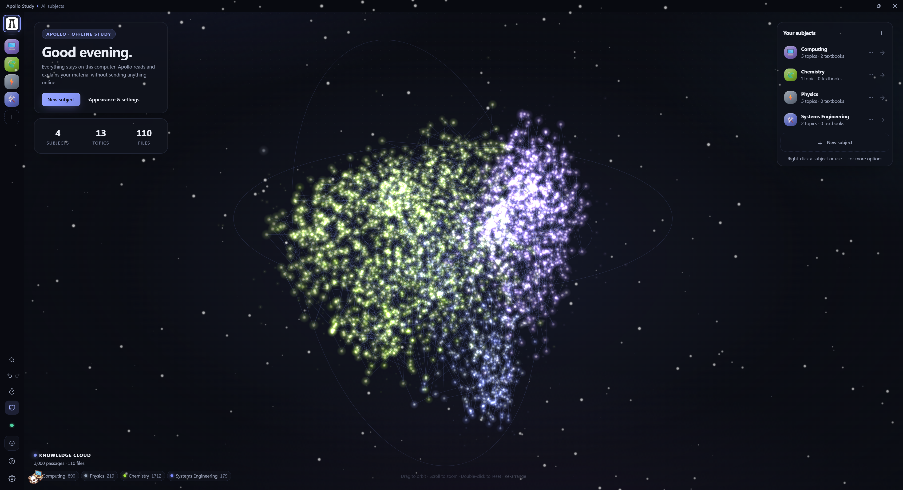
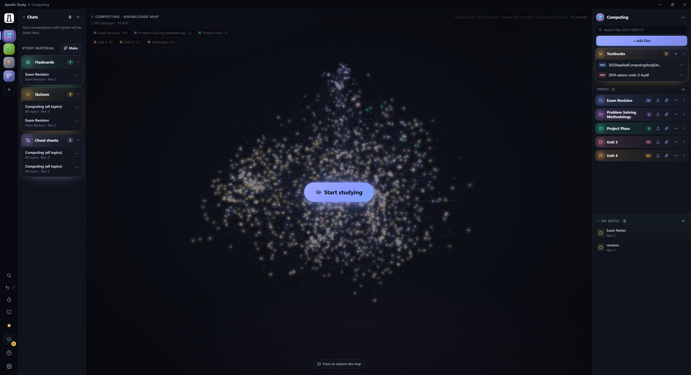
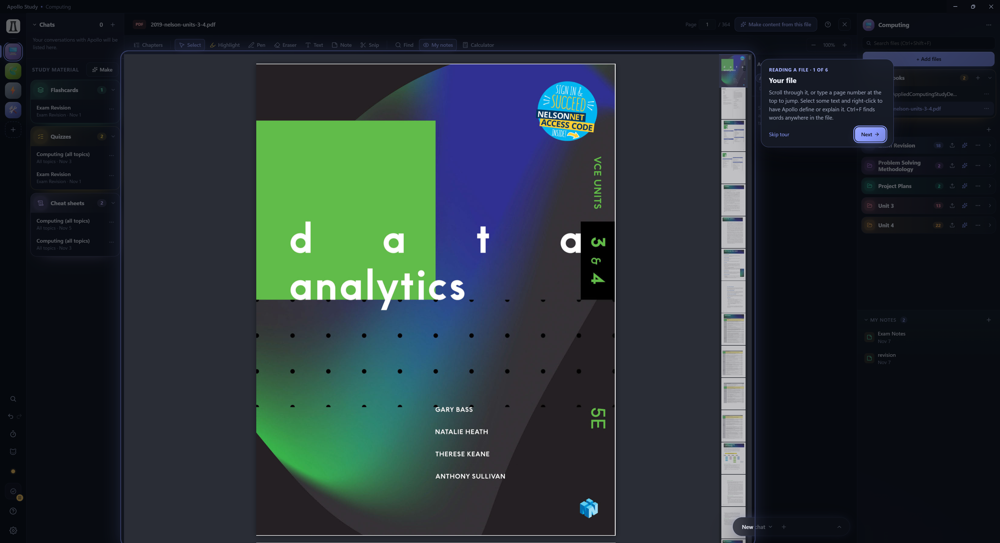
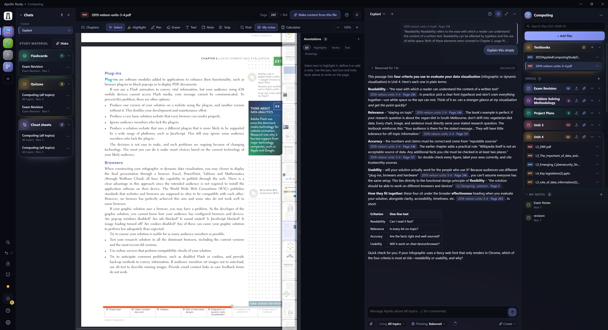
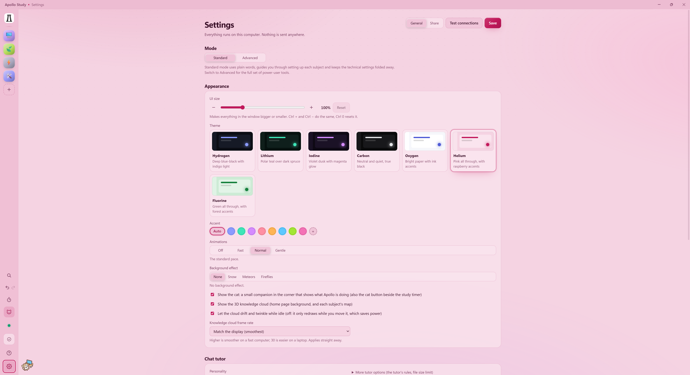
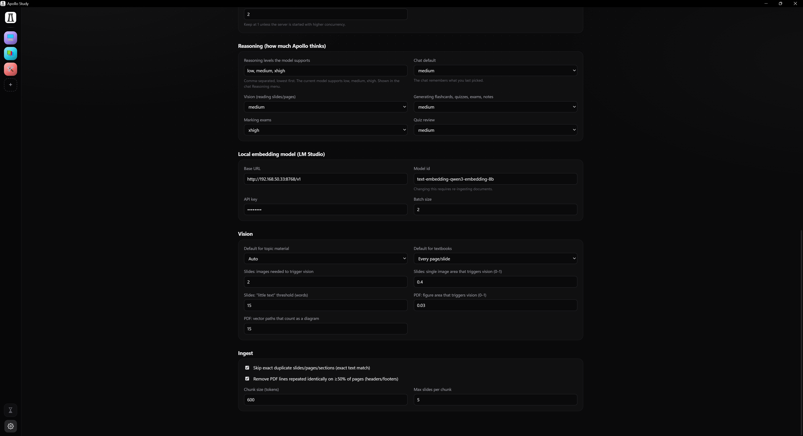

# Apollo (offline AI study app)

Electron + React frontend, Python (FastAPI) sidecar backend. Local models by default; online models via OpenRouter are optional.

## Screenshots

| Home | Subject workspace |
|:--:|:--:|
|  |  |
| Vector database projection cloud of all content | Add specific topics or entire subject materials|

| Document viewer | Chat with citations |
|:--:|:--:|
|  |  |
| Annotate, markup, note and modify any documents like a PDF |Verifiable claims made by an LLM| 

| Settings | Subject menu |
|:--:|:--:|
|  |  |
|Tailor Apollo to suit your needs| Customise the app to your liking |

## Requirements
- OpenAI compatible API (with vision and embedding enabled)
- Node 20+, [uv](https://docs.astral.sh/uv/)

Endpoints, model ids and keys can be changed in the app under **Settings**. On first run they're seeded from a `.env` file in the repo root — copy `.env.example` and fill it in.

### Online models (optional, off by default)
Settings → **Model provider** switches chat/generation and embeddings to [OpenRouter](https://openrouter.ai) independently. Put `OPENROUTER_API_KEY` in `.env` (never commit it). **Anything sent to an online model leaves your computer: it is logged on external servers and may be used for training or other purposes.** The app asks before switching and shows a globe badge in the left bar while online models are on. Free models are often rate limited; requests are retried with backoff.

## Setup (once)
```
cd backend && uv sync
cd ../app && npm install
```

## Run
```
cd app
npm run dev      # Vite + Electron with hot reload (backend on 127.0.0.1:47615)
npm start        # production build of the UI + Electron
```
Electron starts the backend itself and stops it on exit. App data (database, copied files, vision images) lives in `%APPDATA%\Apollo Study\data`.

## Building a Portable exe
```
cd app
npm run dist     # UI build + PyInstaller backend + electron-builder → app/release/ApolloStudy-<version>-portable.exe
```
One self-contained exe (no install). Data still lives in `%APPDATA%\Apollo Study\data`. A `.env` placed next to the exe seeds endpoints and keys on first run. The exe is unsigned, so Windows SmartScreen may warn on first launch ("More info" → "Run anyway").

If electron-builder fails with "Cannot create symbolic link" while unpacking `winCodeSign`, either turn on Windows Developer Mode or unpack that archive manually into `%LOCALAPPDATA%\electron-builder\Cache\winCodeSign\winCodeSign-2.6.0` (the two failing files are macOS-only).

## Tests
```
cd backend
uv run pytest            # offline tests (HTTP mocked, throwaway data dir)
uv run pytest --online   # also live OpenRouter checks (sends synthetic test text only)

cd app
npm test                 # Vitest unit tests (tests/unit)
npm run test:e2e         # Playwright run against a throwaway backend and a fake model server (uses installed Edge)
npm run check            # everything: types, build, unit, backend, Playwright and an Electron smoke run (--quick skips build/e2e)
```
No model or key is needed for any of these. `.github/workflows/check.yml` runs `npm run check` on Windows for every push.

## Using it

### Getting started
1. **Create a subject** — `+` on the left minibar (or *New subject* on the home screen). Right click to customise.
2. **Create a topic** —  Create a topic within a subject to group material and everything you generate.
3. **Upload study material** — Drag files in (PPTX, DOCX, PDF, text, images), or click on `+` to upload reference material. Each file is parsed into units (slides/pages/sections), exactly deduplicated, chunked and embedded.
4. **Vision notes** — a second pass has a vision model annotate slides/pages (auto mode: units with images or little text). Progress shows on the jobs bar at the bottom of the rail (note that this is very slow). The notes are embedded too, so scanned pages and diagrams turn up in search.
   Right-click a subject, topic or file → **Check vision notes** to flag broken or wrong notes (quick checks, then Apollo compares each page with its image); **Settings → Maintenance** lists the flags with the reason, re-runs vision on just those pages, and shows disk use, leftovers to clean up and files that need re-embedding.
5. **Reference library** — Upload entire textbooks and other entire subject materials into the reference libary. All data stays locally on your device (unless an online API is used).

### Chat Window
- Pick a **topic** (or *All topics*) and a **reasoning level** (Off / Low / Medium / XHigh — levels set in Settings), then ask.
- Apollo answers from your material and **cites** it inline — click a citation to open that slide/page.
- Quick actions under the input — **Flashcards, Quiz, Exam, Full notes, Cheat sheet, Mind map** — open a short form, then generate and save to the *Generated* panel (grouped by topic).
- Ask Apollo to generate you this content - it can also tailor it to what you struggle with most.
- A reply keeps writing in its own chat while you switch chats or subjects (a dot marks replies you haven't seen). **Stop** keeps what was written so far.
- **Slash commands** run in the app and never reach the model: `/stats`, `/effort`, `/create`, `/topic`, `/context`, `/todo`, `/new`, `/rename`, `/title`, `/stop`, `/delete`, `/help`. The meter beside the input shows how full the context window is.
- Opening a document floats the chat in a bottom corner: drag its header to move it (or onto a note's Comments panel), drag its inner corner to resize, collapse with ▾. Two header buttons put it **side by side** with what's open (drag the divider) or **full screen**; leaving full screen goes back to the layout you came from.
- Only one blank chat exists per subject. Deleted chats can be brought back with Undo.

### Notes
- **My notes** (right sidebar) are your own rich-text notes. They're never added to Apollo's material, since they may be wrong, but Apollo can read them when you ask it to.
- The toolbar has headings, lists, colours, highlights and **tables**: pick a size from the grid (the first row is a header), Tab moves between cells (Tab in the last cell adds a row), and right-click a cell for rows, columns or deleting the table.
- Highlight text and ask Apollo to **check** or **revise** it; suggestions appear in the Comments panel and only change the note when you apply them (undoable).
- Spell check is offline (Australian English by default; British or US English in Settings). Export a note to Word or PDF.

### Finding things
- **Ctrl+K** searches everything in every subject: subjects, topics, files, chats, generated content and notes.
- **Ctrl+F** finds within the file, note or generated content you last clicked (every page of a PDF, not just the drawn ones). Drag the bar by its grip (double-click the grip to put it back); it closes by itself when you switch to something else.
- The file search at the top of the right sidebar matches file names and the text inside files, and opens a file with the find bar already filled in.

### Organising
- Drag to reorder subjects, topics, to-dos, files and generated content (generated content moves within its own day). Shift/Ctrl-click to select several files or folders.
- **Ctrl+Z / Ctrl+Y** (outside text fields) undo and redo deletes, renames, reorders, highlights and navigation. Deleted chats, generated content and notes stay recoverable for a week.
- The revision to-do list folds away from its heading, like the chat list and My notes.

### Viewing documents
Click a document in a topic to open the viewer. A toolbar in the top right helps you annotate and work through content.

### Studying
- **Quizzes/Flashcards** open fullscreen. With flashcards, mark `✓` / `✗`under each card for confidence. Marking `✗` lets Apollo know in chat the topics you are struggling with.

### Settings
- Endpoints, model ids and keys (local or OpenRouter - online mode is optional; the OpenRouter models are listed to pick from). **Test connections** also checks what the model server supports (reasoning levels, JSON, tools, streamed usage).
- Appearance: themes, accent colour, Reduce motion, 3D knowledge cloud, its idle drift, and its **frame rate** (30 for laptops, 60, 120, or match the display).
- **Maintenance**: disk use, clean-up, re-embedding and re-reading files, vision flags, the log, and database backups (daily and on demand, restored at the next start).
- **Share**: export or import a subject, topic or files as a study pack.
- Where everything is kept, and how to move to a new PC: [`docs/DATA.md`](docs/DATA.md).
- **Browser preview of the UI** (dev only): `http://localhost:5173/?backend=PORT` points the page at a backend on another port.

## Layout
- `backend/studyapp/`: `parsers.py` (PPTX/DOCX/PDF/text/images, native Python), `omml.py` (equations → LaTeX), `dedupe.py` (exact, deterministic), `pipeline.py` (parse → dedupe → chunk → embed → vision notes), `jobs.py` (persistent queue), `search.py` (BM25 + vectors), `context.py` (material Qwen reads), `generate.py` (flashcards/quiz/notes/cheat sheet/exam/mind map + marking), `chats.py` / `chat_reply.py` / `chat_tools.py` / `chat_api.py` (chats, the streaming turn, tool forms), `notes_api.py` + `review.py` (your notes and reviews), `projection.py` (the knowledge cloud), `api.py`
- `app/electron/`: main process (spawns backend, blocks all non-localhost traffic from the UI; online model calls go through the backend), preload
- `app/src/`: React UI (`views/` screens, `components/` shared parts, `styles/` one cascade in five files)
- `app/tests/`: unit, Playwright, Electron, CSS and PDF checks; `backend/tests/`: pytest, incl. golden Office parsing tests
- `docs/`: `DATA.md` (where data lives), `APP_ANALYSIS.md` (known weak spots), `FIX_PLAN.md` and `IMPROVEMENT_PLAN.md` (recent work and its status)
- `spike/`: Phase 0 experiments

## Note
- FULLY vibecoded btw (but it works tho)